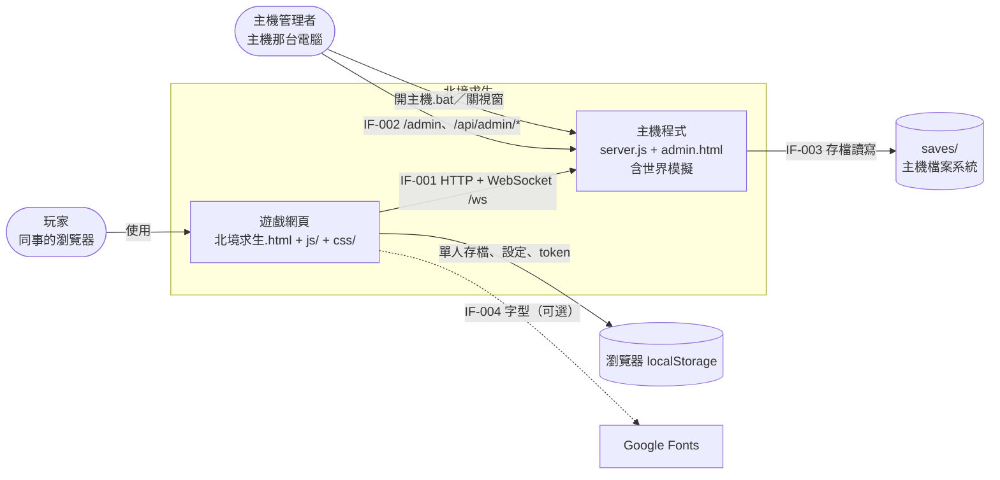
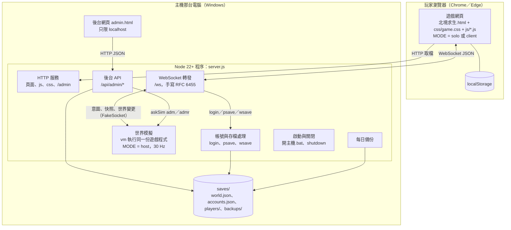
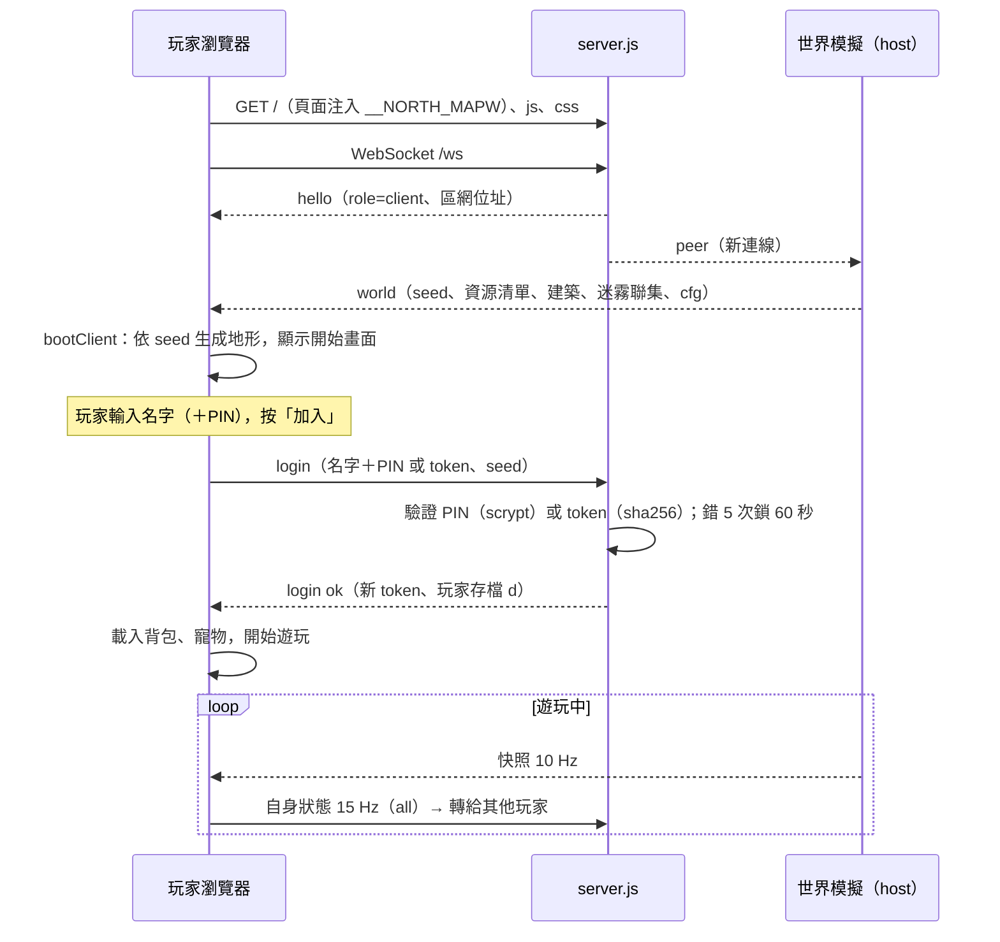
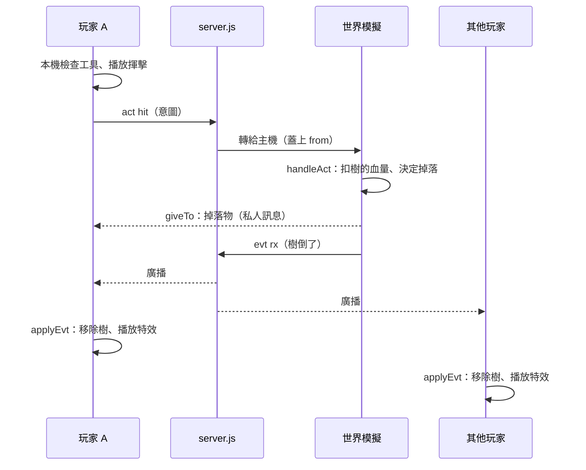
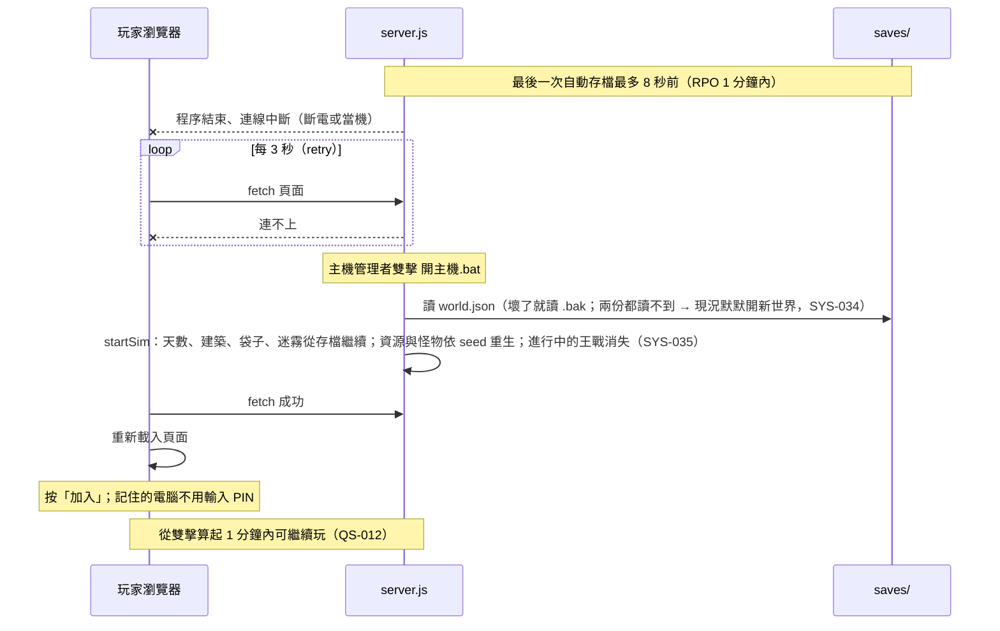
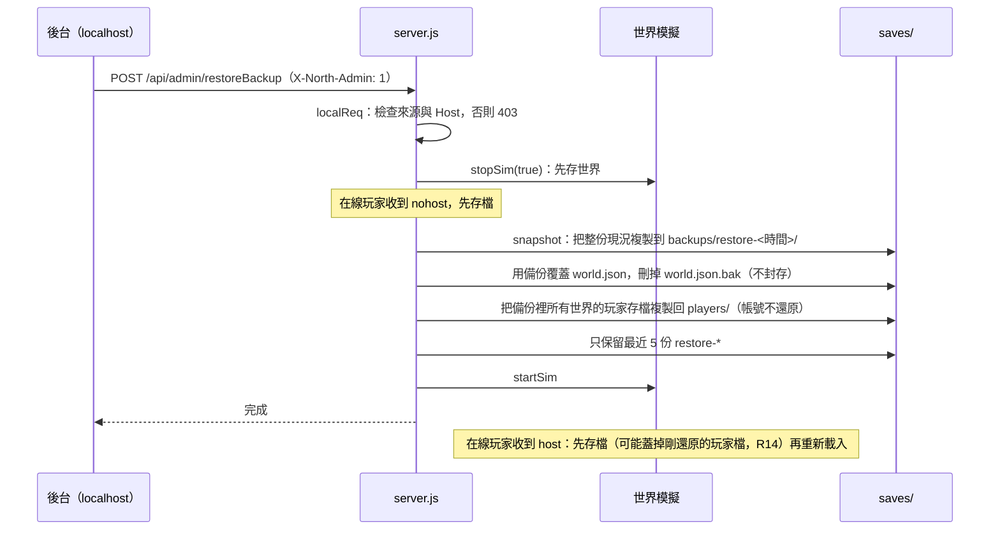
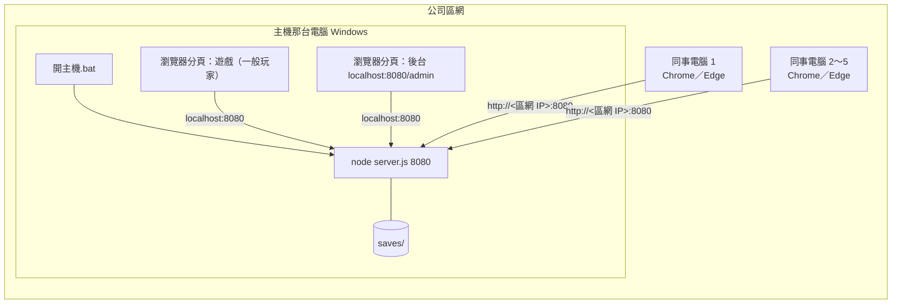

# 北境求生 架構描述

版本：草稿 v0.2（已依審查 RV-01～47 修正） · 最後更新：2026-11-20 · 描述對象：現況（as-is），以 `main` 的 `3147b48` 為準
需求來源：`01-system-requirements.md`。標記說明見 `docs/README.md`。

---

## 1. 架構目標與驅動因素

| 名次 | 品質屬性 | 架構要做到的事 | 情境 |
|---|---|---|---|
| 1 | 可維護性 | 新增王、物品、生態域時，不用碰同步層與存檔架構；同一份遊戲程式同時用在單人、玩家端與 server 模擬 | QS-001～006 |
| 2 | 可復原性 | 世界與玩家資料最多掉 1 分鐘；寫到一半當機也不會壞檔；有每日備份可以還原 | QS-010～013 |
| 3 | 易用性 | 主機零安裝依賴、雙擊就能啟動；玩家只要瀏覽器 | QS-020、021 |
| 4 | 效能 | 6 人、區網、看到世界變化 200 毫秒內；玩家端 60 FPS（可維護性優先） | QS-030～032 |
| 5 | 安全 | 防冒用名字、後台只限本機、存檔裡沒有明文 PIN；防作弊未實作 | QS-040～043 |

## 2. 限制條件摘要

只列出影響架構的限制，完整內容見 `01` 第 6 章。

| CON | 對架構的影響 |
|---|---|
| CON-001 執行時零外部依賴 | WebSocket 自己寫（RFC 6455）；存檔用 JSON 檔，不用資料庫；不用遊戲或網路框架 |
| CON-003 不需建置、classic script | 遊戲程式在瀏覽器與 Node `vm` 裡都要能直接執行；12 個檔案共用一個全域範圍，載入順序由 HTML 決定 |
| CON-005 Chrome／Edge | 可以直接使用 Canvas 2D、`Path2D`、WebSocket、localStorage，不需要相容層 |
| CON-008 Windows 主機 | 一鍵啟動用 `.bat`；關閉視窗時 Windows 會送 SIGHUP，server 要在這時先存檔 |
| CON-009 區網、明文 http | 不處理憑證；安全只靠本機限制與雜湊 |
| CON-013 既有存檔相容 | 地形生成要依 `mapW` 分支，舊 3200 地圖的生成程式不能動 |

## 3. 系統情境與範圍

- 單人模式（`file://`）只有「遊戲網頁 ↔ localStorage」與 IF-004，沒有主機程式。
- 主機管理者也是玩家時，用同一台電腦的另一個分頁走 IF-001。

## 4. 解決方案策略

### 4.1 選定的架構：主機權威世界＋同一份遊戲程式三種模式

| 手法 | 說明 | 對應 |
|---|---|---|
| **同一份遊戲程式、三種模式** | `MODE` 在啟動時決定：`solo`（瀏覽器內全部自己跑）、`client`（玩家分頁）、`host`（只在 server 的 `vm` 裡）。玩法只寫一次 | SYS-001、010；QS-001～003 |
| **server 自己跑世界** | `server.js` 用 Node `vm` 依 HTML 的 `<script>` 順序載入遊戲程式，DOM、畫布換成不做事的替身，以 30 Hz 模擬。沒有任何分頁是主機，關掉分頁不影響世界 | SYS-010、013；QS-012、032 |
| **意圖與世界變更分離** | 玩家端送「意圖」`act`；主機在 `handleAct` 做世界邏輯，再用 `evt` 廣播世界變更；效果寫在 `applyEvt`，讓每個玩家都看得到。現況沒有強制「世界變更只能由主機發出」（R9、SYS-082） | SYS-011；QS-001、004 |
| **玩家自己模擬自己** | 自己的角色與召喚中的寵物在本機模擬，按了立刻動；世界與怪物依主機 10 Hz 快照內插顯示；玩家狀態 15 Hz 廣播 | SYS-011；QS-030、031 |
| **地形決定論** | 地形由 `seed` 決定，玩家端自己重新生成，只傳資源清單；`mapW` 決定用哪一版生成 | SYS-112；CON-013；QS-003 |
| **檔案存檔＋原子寫入** | JSON 檔，先寫暫存檔再改名，覆蓋前留 `.bak`；每 8 秒自動存；每日備份 | SYS-030～041；QS-010～013 |
| **零依賴** | 手寫 WebSocket、只用 Node 內建模組；`開主機.bat` 一鍵啟動 | CON-001；QS-020 |
| **後台只限本機** | loopback＋`localhost` Host＋自訂標頭；即時資料向 sim 查詢（`askSim`） | SYS-060～075；QS-041 |

### 4.2 考慮過的替代方案

| 方案 | 怎麼做 | 為什麼不採用（或已經換掉） |
|---|---|---|
| A. 瀏覽器分頁當主機 | 主機那台電腦的遊戲分頁負責模擬世界，server 只轉發與存檔 | **舊版就是這樣做的**，在 `1ed1807` 改掉。主機分頁一關、切到背景被瀏覽器降頻，世界就停或變慢；主機管理者不能把分頁當一般玩家用 |
| B. 引入框架與資料庫 | server 用 npm 套件（例如 `ws`、遊戲網路框架），存檔改用 SQLite 之類的資料庫，前端用模組與打包工具 | 違反 CON-001（主機管理者要 `npm install`）與 CON-003（不能直接 `file://` 打開、server 無法直接執行同一份程式）。好處（現成的重連、序列化、查詢）在 6 人、幾個 JSON 檔的規模用不到。切換代價：重寫網路層與存檔層，並建立建置流程 |
| C. 完全主機權威（玩家也在主機模擬） | 玩家只送輸入，所有角色、背包都在主機計算，玩家端做預測與校正 | 可以直接解決防作弊（SYS-080～082），但要做客戶端預測與回滾，改動大、程式複雜，跟可維護性第 1 名衝突。目前只把「玩家資料以主機為準、主機事後驗證」列為 Should，而且實作時不能犧牲手感（`01` 5.3） |

## 5. 建構視圖

### 5.1 容器視圖

| 容器 | 技術 | 責任 | 對應 SYS |
|---|---|---|---|
| 遊戲網頁 | HTML＋CSS＋12 個 classic script、Canvas 2D | 單人模式的全部；多人模式的輸入、自己的角色與寵物、繪圖、HUD；斷線重試（`retry`）；多人模式開背包或倒下時世界不暫停 | SYS-001～004、011、013、014、016、036、100～115 |
| HTTP 服務 | Node `http` | 提供 `/`（注入 `window.__NORTH_MAPW`）、`js/*.js`、`css/*.css`、`/admin` | SYS-012、060 |
| WebSocket 轉發 | 手寫 RFC 6455 | 依 `all`／`to`／預設送主機的規則路由訊息，蓋上 `from`；不限制 `all` 的訊息類型、不限制訊息大小（R8、R9） | SYS-011、013 |
| 帳號與存檔處理（`SRV`） | Node `crypto`、`fs` | 登入、PIN 雜湊、token、鎖定、踢掉舊連線；寫世界與玩家存檔 | SYS-020～024、030～032、036 |
| 世界模擬 | Node `vm` | 跑 `MODE='host'` 的遊戲程式：怪物、資源、王、日夜、熔爐、地上袋子、共享迷霧 | SYS-010、030、100～112 |
| 後台 API＋後台網頁 | Node `http`＋`admin.html` | 總覽、世界存檔、備份還原、帳號、即時指令、世界數值 | SYS-041、060～075 |
| 每日備份 | Node `fs`、計時器 | 啟動時與每小時檢查，一天備份一次，保留 7 份 | SYS-040 |
| 啟動與關閉 | `開主機.bat`、`shutdown`（SIGINT／SIGTERM／SIGHUP／SIGBREAK） | 檢查 Node.js、啟動 server、開瀏覽器、顯示區網網址與埠被占用的提示；收到關閉訊號時先存世界再結束 | SYS-033、050～053 |
| `saves/` | JSON 檔 | 多人存檔在**主機端**的唯一保存處（玩家個人資料的準據仍在瀏覽器，見 `01` §8） | SYS-030～042 |

### 5.2 元件視圖：遊戲程式（`js/`）

12 個檔案依序載入，共用同一個全域範圍。後面的檔案可以用前面的定義；載入時就執行的程式不能用後面檔案才宣告的函式。

| 順序 | 檔案 | 責任 | 在 server 模擬中 |
|---|---|---|---|
| 1 | `core.js` | 畫布、`$`、`HEADLESS`、雜訊、localStorage 鍵 | 執行（畫布是替身） |
| 2 | `data.js` | 物品、圖示、食物、武器、護甲、配方、寵物、世界數值 `CFG` | 執行 |
| 3 | `world.js` | 狀態變數、迷霧、地形與生態域生成、`makeMob` | 執行 |
| 4 | `save.js` | 存讀檔、`addStruct`、碰撞 | 執行 |
| 5 | `player.js` | 數值、背包、輸入、設定、音效、快捷欄、戰鬥、採集、耐久 | 執行 |
| 6 | `panel.js` | 建造模式、背包／製作／箱子／熔爐面板、升級、目標 | 執行（DOM 是替身） |
| 7 | `sim.js` | 世界模擬、怪物與王的 AI、本機玩家更新、特效、寵物 | 執行 |
| 8 | `net.js` | `act`／`handleAct`／`evt`、快照、後台指令 `adminDo`、連線 | 執行 |
| 9 | `render.js` | 繪圖（含王的多關節骨架） | 載入但不畫（`HEADLESS`） |
| 10 | `hud.js` | HUD、地圖、表情、地圖標記與 ping | 載入但不畫 |
| 11 | `sea.js` | 魚群與鯊魚裝飾 | 不更新 |
| 12 | `main.js` | 主迴圈 `frame`、開始畫面、登入、啟動（`bootSolo`／`bootHost`／`bootClient`） | 執行 |

主迴圈 `frame()` 每一幀依序呼叫：`updateLocal`（輸入與自己的角色；`paused` 時跳過）→ `updateWorld`（只在 solo／host）→ `tickClient`（只在 client）→ `tickOthers`、`updateFx`（含每 8 秒自動存檔）、`netTick`（快照、迷霧批次、草叢再生）。

## 6. 執行期視圖

### 6.1 玩家登入並加入世界

### 6.2 玩家砍倒一棵樹（意圖 → 世界變更）

### 6.3 失敗情境：主機程式突然停止

- 正常關閉（Ctrl+C、關閉視窗）時，`shutdown` 會先呼叫 `stopSim(true)`，同步寫入世界再結束（SYS-033）。
- 主機程式還在、只有世界模擬停止時（後台切換世界、開新世界、還原備份），玩家收到 `nohost`：先存檔、顯示等待；模擬重新啟動後收到 `host`：先存檔再重新載入（SYS-013）。這兩次存檔正是 R14 的成因。
- 沒有主機時，玩家仍可以操作；本機先扣的材料會隨著被丟棄的意圖消失（R10）。
- 世界模擬某一幀丟出錯誤時，計時器照常排下一幀；錯誤每 300 次印一次到主控台，世界不會整個停住。

### 6.4 主機管理者從備份還原

目標行為（SYS-042，未實作）：還原前先踢出所有在線玩家，並且只還原同一個 seed 的玩家存檔。

## 7. 部署視圖

| 項目 | 內容 |
|---|---|
| 交付物 | `node tools/build.mjs` 產生 `dist/`：內嵌好的單一 `北境求生.html`、`server.js`、`admin.html`、`開主機.bat`、`README.md` |
| 主機需求 | Windows；安裝 Node.js 22+（LTS）；第一次啟動時防火牆選「允許」 |
| 網路 | 監聽 `0.0.0.0:8080`（可用參數換埠）；同事用主控台顯示的區網 IP 連線 |
| 資料位置 | 跟 `server.js` 同一個資料夾的 `saves/`（不進 git） |
| 單人 | 直接用瀏覽器開 `北境求生.html`，不需要主機 |

## 8. 橫切關注點

| 關注點 | 做法 |
|---|---|
| 存檔與相容性 | 單人存檔 `northland-save-v1` 向後相容；世界存檔帶 `mapW`，沒有 `mapW` 的就是舊 3200 地圖，生成程式不能動；地圖陣列在載入時就決定大小，所以 server 會先把 `mapW` 注入頁面，萬一大小不對，分頁會記下正確大小後重新載入（`wrongMapSize`）。之後的新版本可以要求開新世界，不寫新的搬移（CON-013） |
| 原子寫入與備份 | 暫存檔＋改名＋`.bak`；每次都從檔案讀，不快取，所以離線時手動改檔也會生效；每日備份保留 7 份，還原前備份保留 5 份 |
| 錯誤處理 | sim 單幀錯誤不中斷世界；存檔錯誤印到主控台；WebSocket 連不上時退回單人模式；主機停止時玩家端等待、恢復後重新載入 |
| 安全 | PIN 用加鹽 scrypt、token 用 sha256；PIN 錯 5 次鎖 60 秒（只存記憶體）；後台三道檢查（loopback、Host 是 `localhost`／`127.0.0.1`／`[::1]`、自訂標頭）；`adm` 訊息只接受 sim 送出；公告文字會跳脫 HTML；檔名用正規表示式驗證。不做：傳輸加密、防作弊（R1） |
| 日誌與可觀測性 | 只有主控台文字訊息（登入、離線、世界啟停、備份、錯誤）；後台總覽提供即時狀態。沒有日誌檔（可觀測性不在前幾名） |
| server 端模擬的相容 | 載入時會用到的瀏覽器 API，都要在 `startSim` 準備替身；新的頂層瀏覽器 API 要一起補替身，否則 server 上的世界跑不起來（R5） |
| 測試 | `tests/NN-*.mjs` 每個功能一個檔；harness 用 Chrome DevTools protocol，在測試副本注入 `__dbg` 直接讀寫遊戲變數；多人測試自己起 server（埠 18190 起） |
| 程式風格 | Prettier 每行 120 字；每個 js 檔開頭 `'use strict'` |
| 在地化 | 只有繁體中文，沒有多語系機制 |

## 9. 架構決策摘要

| ADR | 標題 | 狀態 | 對應 SYS |
|---|---|---|---|
| [ADR-0001](adr/0001-server-runs-world.md) | 世界由 server 用 vm 執行同一份遊戲程式模擬 | 已接受 | SYS-010、013 |
| [ADR-0002](adr/0002-intent-vs-world-change.md) | 意圖與世界變更分離，玩家自己模擬自己 | 已接受 | SYS-011、080、081 |
| [ADR-0003](adr/0003-zero-runtime-dependencies.md) | 執行時零依賴，手寫 RFC 6455 WebSocket | 已接受 | CON-001 |
| [ADR-0004](adr/0004-classic-scripts-no-build.md) | 遊戲是非模組的 classic script，不需建置 | 已接受 | SYS-001、010；CON-003 |
| [ADR-0005](adr/0005-json-file-saves.md) | 存檔用 JSON 檔、原子寫入、.bak 與每日備份 | 已接受 | SYS-030～041 |
| [ADR-0006](adr/0006-name-pin-login.md) | 名字＋PIN＋記住登入 token，走明文 http | 已接受 | SYS-020～023 |
| [ADR-0007](adr/0007-admin-local-only.md) | 後台只限本機 | 已接受 | SYS-060～075 |
| [ADR-0008](adr/0008-cdp-test-harness.md) | 測試用自寫的 Chrome DevTools protocol harness | 已接受 | QS-005 |

8 份 ADR 都是追認現況的決策，2026-11-20 經開發者確認為「已接受」。

## 10. 品質情境對應

| QS | 由哪些架構手法滿足 | 驗證 |
|---|---|---|
| QS-001 新王 | 同一份程式三種模式；意圖與世界變更分離；王的動畫只由 `m.state` 與移動驅動，玩家端只靠快照就能播 | 下一隻王實作時檢查 `server.js`、路由、存檔架構有沒有被改 |
| QS-002 新物品 | 物品、配方集中在 `js/data.js` | 檢視 |
| QS-003 新地形 | 地形決定論＋依 `mapW` 分支 | 舊存檔載入測試（目前沒有，R2） |
| QS-004 改架構 | 意圖／世界變更規則；存檔原子寫入 | 全部測試 |
| QS-005 測試 | 自寫 harness，不需要 npm | `node tests/run.mjs` |
| QS-006 發佈 | `tools/build.mjs` 內嵌成單一檔 | 展示 |
| QS-010、011 RPO | 每 8 秒自動存（`updateFx`）；切走分頁時存；關閉訊號時同步存 | 檢視（無自動化測試，R2） |
| QS-012 RTO | server 自己跑世界；玩家端收到 `host` 自動重新載入；token 免輸入 PIN | 展示 |
| QS-013 救存檔 | `.bak` 退回；後台備份還原 | `tests/17-admin-saves-accounts.mjs`（只涵蓋還原後的世界天數；`.bak` 退回、帳號不還原、玩家檔還原都沒測，R2） |
| QS-020 開主機 | 零依賴、`開主機.bat`、主控台顯示區網網址 | 展示 |
| QS-021 新玩家 | 名字＋PIN；token 記住登入 | 展示 |
| QS-030 延遲 | 10 Hz 快照、15 Hz 狀態、事件立即廣播 | 未實測（R3） |
| QS-031 60 FPS | 玩家端只模擬自己；一般怪物與角色的外形預先建好 `Path2D` | 未實測（R3） |
| QS-032 30 Hz | server 不畫畫面（`HEADLESS`） | 未實測（R3） |
| QS-040 冒用 | 鎖定與 token | 展示（R2） |
| QS-041 後台 | `localReq`＋自訂標頭 | `tests/17-admin-saves-accounts.mjs` |
| QS-042 作弊 | 未實作 | — |
| QS-043 PIN 雜湊 | scrypt＋sha256 | 檢視 |

## 11. 風險與技術債

| # | 風險／技術債 | 影響 | 因應 |
|---|---|---|---|
| R1 | 玩家個人資料以瀏覽器為準，主機不驗證意圖（SYS-080、081 未實作）；另見 R9 | 改瀏覽器變數就能作弊；STK-005 未達成 | 列為 Should，之後實作；不能犧牲手感 |
| R2 | 一些需求沒有自動化測試，或測試沒驗到需求本身。沒有測試：登入與鎖定（SYS-020、021、023、024）、自動存檔與關主機先存（SYS-030、033）、寫檔原子性與 `.bak` 退回（SYS-032）、單人舊存檔與舊木牆（SYS-002、004）、退回單人與斷線重連（SYS-003、013、016）、世界不暫停（SYS-014）、舊 3200 地形不變（SYS-112）、採集（SYS-101）、建造（SYS-105）、寵物（SYS-109）、觸控（SYS-115）。只驗到一部分：SYS-010（`tests/00` 只看啟動有沒有錯）、SYS-040（`tests/17` 用手動建立的備份）、SYS-041（只驗世界天數） | 改壞了要等實際遊玩才會發現；登入與存檔壞掉會直接影響 STK-003、004 | 之後補測試，登入與存檔優先 |
| R3 | 效能情境 QS-030～032（200 毫秒、60 FPS、30 Hz）都沒有實測過 | 不知道 6 人、王戰時是否達標 | 之後在測試 harness 加入 FPS 與延遲量測 |
| R4 | 12 個檔案共用一個全域範圍，沒有模組邊界 | 名稱衝突、載入順序錯誤只有執行時才會發現；檔案越大越難改 | 靠 `'use strict'`、測試 `00-sim-boot` 與 CLAUDE.md 的規則 |
| R5 | server 用替身執行遊戲程式；新的頂層瀏覽器 API 沒補替身，世界就起不來 | 多人模式整個不能玩 | 測試 `00-sim-boot` 會抓到；CLAUDE.md 有提醒 |
| R6 | 只有主控台日誌，沒有日誌檔 | 當機後很難追原因 | 可觀測性不在前幾名，接受 |
| R7 | 明文 http，PIN 可能被同網路的人看到 | 冒用名字 | 範圍外；README 提醒不要用真實密碼 |
| R8 | WebSocket 沒有限制訊息大小（`parse` 的緩衝會無限累積），`psave` 也沒有大小上限 | 區網內任何人都能讓主機記憶體耗盡、世界停止 | 記錄；之後加上限 |
| R9 | server 會把任何玩家帶 `all` 的訊息轉給所有人；玩家端收到非主機發出的給物品、傷害、退款或世界變更訊息時也照樣執行 | 改過瀏覽器的玩家可以直接改別人的背包與世界，甚至讓世界分岔 | SYS-082（Should，未實作） |
| R10 | 沒有主機時，玩家端仍在本機扣材料再送出意圖，server 直接丟棄送往主機的訊息 | 主機不在的那段時間，做的東西與花的材料會消失 | 記錄；之後可以改成沒有主機時停止本機輸入 |
| R11 | 後台重設 PIN 後，本人重新登入前任何人都能用該名字設定新 PIN；刪除帳號保留玩家存檔，同名新帳號會繼承 | 背包可能被別人拿走 | 接受（使用者決定）；後台操作時提醒管理者 |
| R12 | `開主機.bat` 只檢查有沒有安裝 Node.js，不檢查是不是 22 以上 | 舊版 Node 可能啟動失敗或出現難懂的錯誤 | 記錄；之後在啟動檔或 `server.js` 檢查版本 |
| R13 | 寫檔失敗（例如磁碟滿）只印在主控台 | 主機管理者與玩家都不知道進度沒有存到 | 可觀測性不在前幾名，記錄 |
| R15 | IF-001 沒有協定版本號 | 只重開世界模擬、程式檔卻已換新時，新舊版本可能短暫混用；現況更新程式都要重開 server，玩家會重新載入，所以實際上不會發生 | 接受（使用者決定）；見 IF-001 §6 |
| R16 | 存檔讀不懂時（含帶 BOM 的手改檔）只會默默改讀 `.bak`；`accounts.json` 與 `.bak` 都壞時，所有名字都能被重新註冊、拿到別人的玩家檔 | 手動修改白改、上一版蓋回主檔；帳號被冒用 | BOM：README 提醒存成不帶 BOM 的 UTF-8（使用者決定）；帳號全壞：待決定（IF-003 §7） |
| R14 | 還原備份時，在線玩家的瀏覽器在 `nohost` 與 `host` 時都會先存檔，可能把還原前的背包存回去，蓋掉剛還原的玩家檔（審查推論，待測試確認） | 在線玩家的個人資料實際上沒有被還原 | SYS-042（Should，未實作）；先補測試確認 |

## 12. 名詞
見 `01` 第 1.4 節。
