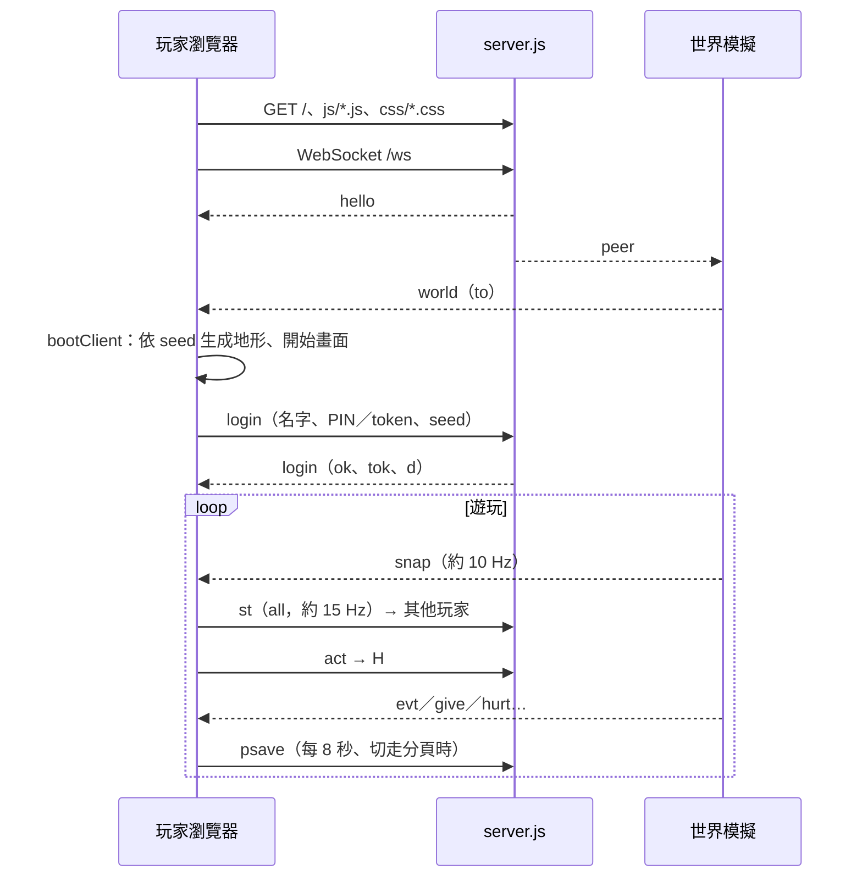

# IF-001：遊戲連線（玩家瀏覽器 ↔ server）

- 狀態：草稿
- 最後更新：2026-11-20（依 `main` 的 `3147b48` 讀 code 整理）
- 對應需求：SYS-003、010～016、020～024、031、036、080～082、111；QS-012、021、030、040、042
- 雙方：本系統的**遊戲網頁**（`北境求生.html`＋`js/`，主要在 `js/net.js`、`js/main.js`）↔ 本系統的**主機程式**（`server.js`）與它執行的**世界模擬**（同一份遊戲程式，`MODE='host'`）
- 擁有者：兩端都是開發者。沒有外部窗口；只有網路放行要問公司 IT（第 7 節）

**內容來源標記**：本文件沒有對方決定的內容。「**現況**」是從 code 讀出、我們已經決定並實作的；「**目標**」是規格裡標「未實作」的需求；`<待確認>` 是還沒量測或還沒決定的。

---

## 1. 概述

多人模式的唯一通道。玩家的瀏覽器從主機程式取得遊戲網頁，再用一條 WebSocket 連線：
- 登入、取得世界的初始狀態；
- 送出自己的**意圖**（`act`）與**自身狀態**（15 Hz）；
- 收到主機的**快照**（10 Hz）、**世界變更**（`evt`）與**私人訊息**（給物品、受傷、馴服等）。

主機程式本身不懂玩法：它負責路由、蓋上發送者、處理登入與存檔。玩法由世界模擬決定。世界模擬也是 WebSocket 的一個「端點」，只是用 `FakeSocket` 直接接在 server 內部。

## 2. 協定與傳輸

| 項目 | 內容（現況） |
|---|---|
| 協定 | HTTP/1.1；WebSocket（RFC 6455，`server.js` 手寫，只支援文字訊框） |
| 位址 | `http://<主機區網 IP>:<埠>/`，埠預設 8080（`node server.js <埠>` 可改）；監聽 `0.0.0.0` |
| HTTP 路徑 | `/` 或 `/index.html`：遊戲網頁，若已知地圖大小，會在第一個 `<script>` 前注入 `window.__NORTH_MAPW=<mapW>`；`/js/<名稱>.js`、`/css/<名稱>.css`：只認這兩個資料夾、檔名限 `[\w.-]+`；`/admin`、`/api/admin/*`：見 IF-002；其他路徑 → 404 |
| HTTP 快取 | 全部回應 `Cache-Control: no-store`（更新程式後重新整理就拿到新版） |
| WebSocket 路徑 | `/ws`；必須有 `Upgrade: websocket` 與 `Sec-WebSocket-Key`，否則直接斷開 |
| 訊框 | 文字（opcode 1），支援分段；回應 ping（9→10）；收到 close（8）就回 close 並結束；不支援壓縮擴充 |
| 編碼 | 每則訊息是一個 UTF-8 JSON 物件，必有字串欄位 `t`（訊息類型）。中文名字、全形字照 UTF-8 傳，沒有額外跳脫 |
| 訊息大小 | **沒有上限**（R8）。`world` 訊息一次帶整張地圖的資源清單，大小 `<待確認：14400 地圖的 world 訊息實測大小>` |
| 認證與授權 | 連線本身不認證。server 給每條連線一個遞增的 peer id，收到的訊息一律蓋上 `from=<peer id>`（玩家無法偽造 `from`）。帳號登入在連線之後（`login`，見 4.2），但**登入前後能送的訊息類型沒有差別**（R9）。後台查詢 `adm` 只接受世界模擬發出 |
| 傳輸加密 | 無（明文，範圍外，R7）。玩家端會依頁面協定選 `ws://`／`wss://`，但 server 不支援 TLS |
| 時間 | 訊息裡沒有牆鐘時間戳；遊戲時間用 `day`（天數）與 `dt`（一天內的進度 0～1） |

### 2.1 路由規則（`server.js` `onMsg`）

| 條件 | 送給誰 |
|---|---|
| `t` 是 `login`／`psave`／`wsave`／`admr` | 不轉發，由 server 自己處理（`SRV`） |
| `t` 是 `adm` 且不是世界模擬送的 | 丟棄 |
| 帶 `all` | 除了發送者以外的所有人（含世界模擬）；**不限制類型**（R9） |
| 世界模擬送的、帶 `to` | 只給那個 peer |
| 世界模擬送的、不帶 `to` | 所有玩家 |
| 其他 | 世界模擬；世界模擬不在時**直接丟棄**（R10） |

**目標（SYS-082，未實作）**：`all` 只允許白名單類型（`st`、`fog`、`ping`）；玩家端只接受 `from` 是世界模擬的世界變更、給物品、傷害、退款訊息。

## 3. 訊息定義

方向：**B** = 玩家瀏覽器，**S** = server 自己，**H** = 世界模擬（host）。

### 3.1 連線與帳號（逐欄）

| 類型 | 方向 | 欄位 | 說明 |
|---|---|---|---|
| `hello` | S → B／H | `id`（peer id）、`role`（`client`／`host`）、`hostReady`（世界模擬是否在）、`local`（是否本機連線）、`ips`（主機區網 IPv4 清單）、`port`、`world`（只給 H：`world.json` 內容） | 連線建立後第一則。`local` 為真時，開始畫面顯示同事網址與後台連結 |
| `peer` | S → H | `id` | 有新玩家連線；H 回 `world` |
| `world` | H → B（`to`） | `cfg`、`mapW`、`seed`、`day`、`dt`、`fs`（召喚旗標）、`fb`（擊敗旗標）、`structs`（`[k,x,y,o?,內容?]`）、`res`（`[cell, 種類索引, x, y, hp, dep]`）、`loots`（`[id,x,y,bag,g]`）、`seen`（共享迷霧，壓縮字串） | 世界初始狀態；B 依 `seed` 自己生成地形，再用 `res` 取代資源 |
| `login` | B → S | `n`（名字）、`pin`（字串，可空）、`tok`（這台電腦記住的 token，可空）、`seed` | 按「加入」才送；`seed` 來自 `world` |
| `login` | S → B | 成功：`ok:1`、`n`、`tok`（新 token 或沿用）、`d`（玩家存檔，沒有就是 `null`）；失敗：`ok:0`、`msg`（中文原因） | 規則見 SYS-020～024；名字去掉前後空白、截到 10 個字 |
| `psave` | B → S | `d`（`personal()`：背包、快捷欄、裝備、寵物、個人迷霧等）、`ack`（1 = 要回 `saved`） | 未登入時忽略；server 整份寫入玩家存檔（現況，SYS-081 目標是改成主機為準） |
| `wsave` | H → S | `d`（`worldData()`）、`ack` | 只接受世界模擬送的 |
| `saved` | S → B | `k`（`p`／`w`） | 回應帶 `ack` 的存檔；B 收到後刪掉瀏覽器裡的舊版副本（SYS-036） |
| `kicked` | S → B | `why`（可省略；後台踢人時帶原因） | 同名新登入或後台踢出；B 停止存檔、不重連 |
| `leave` | S → 全部 | `id` | 有玩家離線 |
| `host` | S → B | — | 世界模擬開始運作；B 先存檔再重新載入（SYS-013） |
| `nohost` | S → B | — | 世界模擬停止；B 先存檔、顯示等待 |
| `adm` | S → H | `q`（查詢編號）、`c`（指令）、`v`（參數） | 後台查詢或指令，見 IF-002 |
| `admr` | H → S | `q`、`d`（狀態：seed、天數、怪物數、王、cfg、`err` 等） | 只接受世界模擬送的 |

### 3.2 同步（逐欄）

| 類型 | 方向 | 頻率 | 欄位 |
|---|---|---|---|
| `snap` | H → 全部玩家 | 約每 0.1 秒（`snapT`，每幀檢查，不補償，實際約 7.5～10 Hz） | `day`、`dt`、`fs`、`fb`、`b`（醒著的王的 mob id，0 = 沒有）、`wp`（世界暫停 1／0）、`m`：每隻怪物 `[id, 種類, x, y, 面向, hp, max, 受擊閃光, state, 激怒, 暈眩]` |
| `st` | B → 全部（`all`） | 約每 1/15 秒，登入開始遊玩後 | `n`（名字）、`x`、`y`、`f`（面向）、`w`（武器）、`s`（揮擊進度）、`r`（翻滾）、`h`（受傷）、`a`（外觀）、`em`（表情）、`bl`（格擋）、`sh`（副手）、`ro`（被纏住）、`d`（死亡）、`b`（在船上）；召喚寵物時另有 `pk`、`px`、`py`、`pf` 等 |
| `fog` | B → 全部（`all`，世界模擬也會收到並記下聯集） | 有新看到的格子時，最多每 0.25 秒一批 | `c`：格子索引陣列 |
| `ping` | B → 全部（`all`） | 玩家按 ping 時 | 地圖 ping 的位置與發送者（細節見 `js/hud.js`） |

### 3.3 意圖 `act`（B → H；只列用途，欄位以 `js/net.js` `handleAct` 為準）

玩家端先做跟自己背包有關的檢查並扣掉材料，再送意圖；主機拒絕建造時用 `refund` 退回。

| 類型 | 用途 |
|---|---|
| `hit` | 攻擊（扇形範圍內的敵人、資源） |
| `res` | 撿起地上的小資源 |
| `feed` | 餵食馴服 |
| `drop`／`pick` | 丟出物品成地上袋子／撿起袋子 |
| `fput`／`fout` | 放進熔爐／取出成品 |
| `cput`／`cget` | 放進儲存箱／取出 |
| `build`／`demo` | 蓋建築／拆建築 |
| `board`／`unboard` | 上船／下船 |
| `sleep` | 睡覺（跳到天亮） |
| `summon`／`summont` | 在祭壇召喚灰鬃狼王／樹精長老 |
| `plant`／`harv` | 種植／收成 |
| `parry` | 格擋反擊 |
| `shot` | 遠程攻擊（法杖） |

意圖帶 `pet:1` 時代表是召喚中的寵物做的。

### 3.4 世界變更 `evt`（H → 全部玩家；只列用途，欄位以 `applyEvt` 為準）

| 類型 | 用途 | 類型 | 用途 |
|---|---|---|---|
| `rh` | 資源受擊（血量變化） | `ra` | 新增資源（含樹精長老的樹牆） |
| `rx` | 資源被採完／移除 | `bd` | 草叢被採（進入再生倒數） |
| `sa` | 新增建築 | `sr` | 移除建築 |
| `fz` | 熔爐狀態更新 | `cb` | 儲存箱內容更新 |
| `cp` | 農地作物更新 | `ld`／`lr` | 地上袋子出現／被撿走或改變 |
| `mk` | 怪物死亡 | `tm` | 馴服成功的特效 |
| `bn` | 全畫面橫幅（天數、王戰、公告） | `cfg` | 世界數值改變 |
| `cl`／`rr` | 狼王三連抓／怒吼特效 | `ts`／`rm`／`ru` | 樹精長老重擊／根鬚標記／根鬚爆發 |
| `sd`／`sx` | 樹精種子彈出現／消失 | `sh` | 遠程彈道 |
| `fg` | 黑霧 | `et`／`tf`／`tc` | 樹精長老吞食回血／自然恢復／施法文字 |
| `sp` | 小樹精出現的特效 | `pr` | 格擋成功的特效 |

### 3.5 私人訊息（H → 單一玩家，`to`）

| 類型 | 用途 |
|---|---|
| `give` | 給物品（`k` 物品、`n` 數量、`x`、`y` 掉落位置、`p` 是否給寵物） |
| `refund` | 退回材料（`cost`、`msg`） |
| `hurt`／`phurt` | 玩家／寵物受到傷害（`dmg` 等）；翻滾與無敵時間由收到的玩家端判斷 |
| `root` | 被根鬚纏住（`d` 秒數） |
| `love`／`tame` | 馴服進度／馴服成功 |
| `pup`／`tdown` | 第一次打倒狼王／樹精長老的獎勵 |
| `board` | 上船結果 |

## 4. 互動流程

### 4.1 加入世界

### 4.2 一個意圖的往返

`act` → server 蓋 `from` 轉給 H → `handleAct` → 世界變更用 `evt` 廣播、掉落用 `give` 私送 → 各玩家 `applyEvt` 顯示特效。詳見 `02` §6.2。

## 5. 錯誤處理與失效行為

| 情況 | 行為（現況） |
|---|---|
| 一開始就連不上 WebSocket | 退回單人模式（SYS-003） |
| 收到無法解析的 JSON | 兩端都直接忽略 |
| 世界模擬停止（後台切換世界等） | 玩家收到 `nohost`：存檔、顯示等待；回來時收到 `host`：存檔、重新載入（SYS-013） |
| 與 server 的連線中斷 | 玩家存檔、顯示「重新連線中」，每 3 秒 `fetch` 頁面一次，成功就重新載入（SYS-016）；被 `kicked` 的分頁不重連 |
| 世界模擬不在時送出的意圖 | server 直接丟棄；玩家端先扣的材料就消失（R10） |
| 主機拒絕建造 | `refund` 退回材料並顯示原因 |
| 登入失敗 | `login ok:0` 帶中文原因；連錯 5 次 PIN 鎖 60 秒 |
| 同名重複登入 | 舊連線收到 `kicked` 並被關閉 |

**冪等性與重送**：意圖沒有編號、沒有回覆確認，也不會重送；WebSocket 在 TCP 上保證順序且不重複，所以不會重複處理，但連線中斷時在途的意圖會遺失。`psave` 每次送整份，重送是冪等的（後到的覆蓋先到的）。

**逾時**：沒有應用層逾時。非冪等的意圖（例如 `build`）在連線中斷時，玩家端無從得知主機是否已處理；重新載入後以主機送來的 `world` 為準。

## 6. 非功能

| 項目 | 內容 |
|---|---|
| 同時連線 | 目標 6 位玩家（QS-030）；server 沒有連線數上限 |
| 延遲 | 世界變化到其他玩家看到 200 毫秒內（QS-030，未實測，R3） |
| 頻寬 | `<待確認：6 人、王戰時每位玩家的上下行頻寬，可實測>` |
| 大量資料 | `world` 一次送完整張地圖的資源，不分頁；`snap` 每次帶全部怪物 |
| 版本相容 | **沒有協定版本號**。server 與網頁的程式來自同一個資料夾；更新程式要重開 server，玩家會斷線、重新載入新版頁面，所以現況不會新舊混用。若只重開世界模擬（不重開 server）且程式檔已被換掉，已開著的分頁收到 `host` 時也會重新載入（R15） |
| 測試環境 | 自動化測試用 `tests/lib/harness.mjs` 自己起 server，埠從 18190 起；不需要另外的測試主機或測試資料 |
| 憑證、密鑰 | 無（沒有 TLS）。玩家的記住登入 token 存在瀏覽器 `northland-tok`，server 只存雜湊；不會過期，每個名字最多保留 5 個，超過就淘汰最舊的 |

## 7. 待確認問題

這條介面兩端都是本系統，沒有要問外部窗口的協定問題。剩下的分兩類：

### 7.1 要問公司 IT（可以直接貼進 email）

> 主旨：詢問區網內個人電腦開放遊戲服務埠的規定
>
> 我們幾位同事想在午休、下班後用一個瀏覽器小遊戲連線一起玩。遊戲由其中一台 Windows 電腦（下稱主機）提供，同事用瀏覽器連過去。想請教以下幾點：
>
> **連線**
> 1. 公司區網是否允許同事的電腦連到主機的 TCP 8080 埠（http）？目前測試是連得到的，想確認這樣是否符合規定。若有指定可用的埠，我們可以改。
>    — 為什麼要知道：埠被擋或不合規定，多人模式就不能用。
> 2. 主機第一次啟動時，Windows 防火牆會詢問是否允許 Node.js 接受連線。一般員工是否可以自行選「允許」（私人網路）？還是要由 IT 設定？
>    — 為什麼要知道：決定說明文件怎麼寫，以及要不要另外申請。
>
> **安全**
> 3. 連線是明文 http（不是 https）。遊戲只傳遊戲資料與玩家自訂的 4～8 位數字 PIN，我們會提醒大家不要用真實密碼。這樣是否可以？
>    — 我們偏好的答案：可以，因為不傳任何公司資料或個人資料。
> 4. 遊戲網頁會從 Google Fonts 下載一個字型；連不到時會改用系統字型，不影響使用。這個外部連線是否需要注意？
>    — 我們偏好的答案：可以，或者封鎖也沒關係。
>
> **使用時間**
> 5. 是否有規定只能在午休或下班時間使用這類服務？
>
> 謝謝！

### 7.2 開發者自己要量測或決定

| # | 問題 | 影響 |
|---|---|---|
| 1 | 14400 地圖的 `world` 訊息實際大小 | 第 2、6 節；R8 的上限要設多少 |
| 2 | 6 人、王戰時每位玩家的頻寬 | 第 6 節 |
| 3 | 訊息大小上限要設多少（處理 R8 時） | 第 2 節 |

## 8. 申請項目

| 項目 | 對象 | 內容 | 狀態 |
|---|---|---|---|
| Windows 防火牆允許 Node.js 接受連線 | 主機那台電腦（主機管理者或 IT） | 允許 `node.exe` 在私人網路接受 TCP 連線（預設埠 8080） | 現況由主機管理者第一次啟動時自己選「允許」；是否需要 IT 處理 `<待確認：問公司 IT>` |
| 公司區網放行 | 公司 IT | 同網段的電腦連到主機 TCP 8080 | `<待確認：問公司 IT>`；目前實際連得到 |
