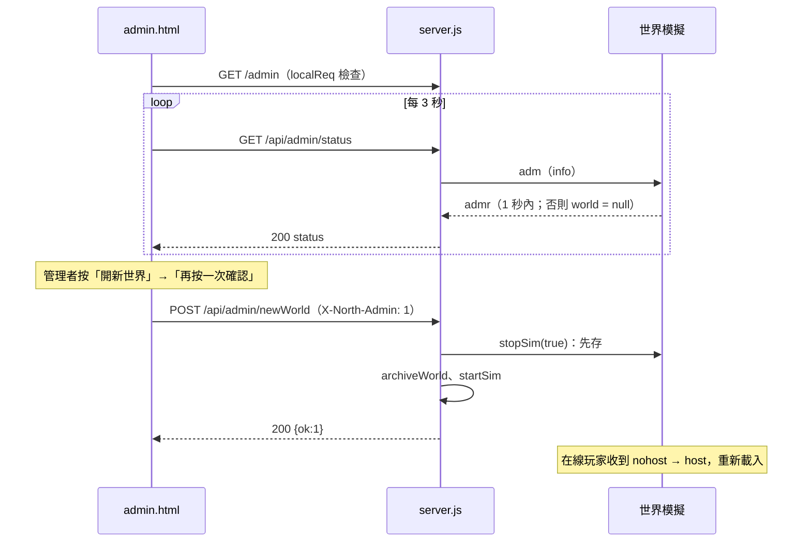

# IF-002：後台 API（主機管理者瀏覽器 ↔ server）

- 狀態：草稿
- 最後更新：2026-11-20（依 `main` 的 `3147b48` 讀 code 整理；`server.js` 的 `admin()`、`ADMIN_GET`、`ADMIN_POST`）
- 對應需求：SYS-040～042、SYS-060～075；QS-013、QS-041
- 雙方：本系統的**後台網頁**（`admin.html`）↔ 本系統的**主機程式**（`server.js`）。即時資料與指令再經 IF-001 的 `adm`／`admr` 轉給世界模擬
- 擁有者：兩端都是開發者。沒有外部窗口，也不需要開防火牆（只接受本機連線）

**內容來源標記**：本文件沒有對方決定的內容。「**現況**」是從 code 讀出、已經實作的；「**目標**」是規格裡標「未實作」的需求。

---

## 1. 概述

讓主機管理者在主機那台電腦上，用瀏覽器管理世界存檔、備份、帳號、世界即時狀態與世界數值，不用手動改 `saves/` 裡的檔案（STK-011、012）。唯一的使用方是 `admin.html`；它打開時畫一次總覽，之後每 3 秒用 `status` 更新。其他頁面只在操作後才重新讀取。

## 2. 協定與傳輸

| 項目 | 內容（現況） |
|---|---|
| 協定 | HTTP/1.1，同步請求／回應 |
| 位址 | `http://localhost:<埠>/admin`（網頁）、`http://localhost:<埠>/api/admin/<名稱>`（API）；埠跟遊戲相同，預設 8080 |
| 方法 | 讀取用 `GET`（參數放 query string）；會改變狀態的用 `POST`（body 是 JSON） |
| 編碼 | 請求與回應都是 UTF-8 JSON（`Content-Type: application/json; charset=utf-8`）；帳號名稱可以是中文 |
| 快取 | 回應都帶 `Cache-Control: no-store` |
| 存取控制（SYS-060） | ① 連線來源必須是 loopback（`127.0.0.1`、`::1`、`::ffff:127.0.0.1`）；② `Host` 標頭必須是 `localhost`、`127.0.0.1` 或 `[::1]`（可帶埠）；①② 不符 → `403`，純文字「後台只能在主機這台電腦，用 http://localhost 打開。」③ `POST` 必須帶 `X-North-Admin: 1`，否則 `403 {"err":"拒絕"}`。沒有帳號密碼（ADR-0007）。**不處理 `OPTIONS` 預檢**，這是 ③ 能擋跨站請求的前提 |
| 請求大小 | `POST` body 超過 100,000 字元時直接中斷連線，沒有回應 |
| 時間 | `uptime` 是毫秒數；`mtime`、`last` 是 Unix 毫秒時間戳（由瀏覽器依本機時區顯示）；封存與備份的名稱用主機的**本地時間**（`world-YYYYMMDD-HHMMSS.json`、`YYYYMMDD`、`restore-YYYYMMDD-HHMMSS`） |
| 加密 | 無（只在本機，不經過網路） |

## 3. 端點定義

### 3.1 共通回應

| 情況 | 狀態碼 | body |
|---|---|---|
| 成功（GET） | 200 | 各端點的物件 |
| 成功（POST，沒有特別回傳） | 200 | `{"ok":1}` |
| 端點名稱不存在 | 404 | `{"err":"沒有這個功能"}` |
| GET 處理時出錯 | 500 | `{"err":"<中文原因>"}` |
| POST body 不是 JSON | 400 | `{"err":"格式錯誤"}` |
| POST 處理時出錯（含參數錯、找不到、**世界沒有在跑、世界沒有回應**） | 400 | `{"err":"<中文原因>"}` |

所有 POST 錯誤都回 400，不區分原因（使用者決定維持現況：唯一使用方只顯示 `err` 文字）。

### 3.2 讀取（GET）

| 端點 | 參數 | 回應欄位 | 說明 |
|---|---|---|---|
| `status` | — | `uptime`、`port`、`ips`（區網 IPv4）、`running`（世界模擬是否在）、`world`（世界即時狀態，見 3.4；沒有回應時 `null`）、`saved`（`world.json` 的檔案資訊，見 3.5）、`online`：`[{id, name, addr, local}]`（`name` 未登入時為 `null`） | 總覽（SYS-061） |
| `worlds` | — | `current`（`world.json` 的檔案資訊）、`archived`（封存世界，新的在前）、`backups`：`[{name, restore, world, players}]`（`restore` 表示是還原前的自動備份；`world` 是備份裡世界的檔案資訊；`players` 是玩家檔數量） | 世界存檔頁（SYS-062） |
| `accounts` | — | `seed`（目前世界）、`list`：`[{name, pin（是否有 PIN）, devices（記住的電腦數）, online, last（在目前世界最後存檔時間，沒有就 null）, worlds（在幾個世界有存檔）}]`，依名字排序 | 帳號頁（SYS-063） |
| `cfg` | — | `cfg`（目前世界數值）、`def`：`{num: {鍵: [預設, 最小, 最大]}, bool: {鍵: 預設}, death: ["keep","bag","all"]}` | 世界數值頁（SYS-075）；世界沒在跑 → 500 `世界沒有在跑` |
| `download` | `f=<世界檔名>` 或 `b=<備份名稱>` | 檔案本身（`Content-Disposition: attachment`，檔名 UTF-8 編碼；備份下載名為 `world-backup-<名稱>.json`） | 只下載世界檔，不含玩家檔；找不到 → 404 `找不到檔案` |

### 3.3 操作（POST）

| 端點 | body | 回應 | 行為 | 冪等？ |
|---|---|---|---|---|
| `world` | `{c, v?}`；`c` ∈ `pause`／`resume`／`time`／`clearMobs`／`endBoss`／`announce`；`time` 的 `v` ∈ `morning`／`noon`／`dusk`／`night`；`announce` 的 `v` 是文字（server 截到 60 字、世界再截到 40 字並跳脫 HTML） | `{ok:1, world}` | 經 `askSim` 交給世界模擬執行（SYS-070）。`pause` 不存檔 | `pause`／`resume`／`time` 是；`clearMobs` 實際上是；`endBoss` 第二次會回「現在沒有王醒著」；`announce` 每次都發一次 |
| `cfg` | `{v?: {鍵: 值}, reset?: true}` | `{ok:1, world}` | 只改 `v` 裡的幾項，世界會把數值夾在範圍內；`reset` 全部恢復預設；立即廣播給所有玩家並存檔（SYS-075） | 是 |
| `newWorld` | `{}` | `{ok:1}` | 停止世界（先存）→ 封存成 `world-<時間>.json` → 開一個新 seed 的世界 | **否**：送兩次就開兩個新世界（第一個被封存，不會遺失） |
| `switchWorld` | `{file}`（封存世界檔名，不能是 `world.json`） | `{ok:1}` | 停止世界（先存）→ 封存目前世界 → 把選的檔改名成 `world.json` → 啟動 | **否**：第二次送同一個 `file` 會回「找不到這個封存的世界」 |
| `deleteWorld` | `{file}`（同上） | `{ok:1}` | 刪除封存世界檔；**該世界的玩家存檔留著**（使用者決定維持現況） | 第二次回「找不到」 |
| `restoreBackup` | `{name}`（`YYYYMMDD` 或 `restore-YYYYMMDD-HHMMSS`） | `{ok:1}` | 見 SYS-041 與 `02` §6.4：先存世界 → 整份現況備份到 `restore-<時間>` → 覆蓋 `world.json`、複製備份裡**所有世界**的玩家檔 → 只留 5 份 `restore-*` → 啟動；帳號不還原 | **否**：每次都會再多一份 `restore-*`，並把還原後的進度蓋回備份內容 |
| `resetPin` | `{name}` | `{ok:1}` | 刪除該名字的 PIN 與所有記住的電腦，踢出在線連線並告知原因；下次登入輸入的 PIN 就是新的（R11） | 是 |
| `kick` | `{name}` | `{ok:1}` | 踢出該名字的在線連線並告知原因 | 第二次回「這個人不在線上」 |
| `deleteAccount` | `{name}` | `{ok:1}` | 刪除帳號、踢出在線連線；**玩家存檔留著**，之後註冊同名的人會拿到（R11） | 第二次回「找不到這個帳號」 |

非冪等的操作由 `admin.html` 的「再按一次確認」按鈕防止誤按（使用者決定維持現況，不另做請求編號）。

### 3.4 世界即時狀態（`world` 欄位，來自 IF-001 的 `admr`）

`seed`、`mapW`、`day`、`dayT`（0～1）、`night`、`paused`、`mobs`（怪物數）、`boss`（`灰鬃狼王`／`樹精長老`／`null`）、`structs`（建築數）、`loots`（地上袋子數）、`cfg`、`cfgDef`（只在非 `info` 查詢時）、`err`（指令失敗原因）。

### 3.5 檔案資訊

`{file, seed, mapW（沒有 mapW 的舊存檔為 3200）, day, size（位元組）, mtime, players（同 seed 的玩家檔數）}`；檔案不存在時整個是 `null`。

## 4. 互動流程

## 5. 錯誤處理與失效行為

| 情況 | 行為（現況） |
|---|---|
| 世界模擬沒在跑 | `status.running=false`、`world=null`；`cfg`（GET）回 500；`world`、`cfg`（POST）回 400「世界沒有在跑」；存檔類操作照常可用 |
| 世界模擬 1 秒內沒回應 | `status.world=null`；POST 回 400「世界沒有回應」，**指令可能其實已經執行**（例如公告晚到） |
| 檔名或備份名稱不符格式 | 400「找不到…」；名稱用 `WORLD_RE`、`BACKUP_RE` 檢查，不能用 `..` 跳出 `saves/` |
| 寫檔失敗（磁碟滿等） | 400 帶系統錯誤訊息；同時主控台記錄（R13） |
| 操作執行到一半出錯（例如封存後啟動失敗） | 沒有回滾；已封存的檔案留在 `saves/`，主控台記錄 |

**逾時後的狀態**：`newWorld`、`switchWorld`、`restoreBackup` 是同步執行完才回應，通常在幾秒內。如果瀏覽器端沒收到回應，重新讀取 `worlds` 就能判斷有沒有做過：看 `current` 的 seed，以及 `archived`、`backups` 有沒有多出新項目。

## 6. 非功能

| 項目 | 內容 |
|---|---|
| 使用者數 | 1 位（主機那台電腦前的主機管理者）；server 不處理並行操作的衝突 |
| 頻率 | 總覽頁每 3 秒一次 `status`；其他只在手動操作時 |
| 大量資料 | 不分頁。`worlds` 列出全部封存世界與備份（備份最多 7 份每日＋5 份 `restore-*`，封存世界沒有上限）；`accounts` 列出全部帳號 |
| 版本相容 | 沒有版本號；`admin.html` 與 `server.js` 在同一個資料夾、一起發佈 |
| 稽核 | 每個 POST 操作在主控台印一行（例如「後台：刪除 world-….json」），沒有寫入檔案 |
| 測試 | `tests/17-admin-saves-accounts.mjs`（存檔與帳號）、`tests/18-admin-world-control.mjs`（即時指令）、`tests/19-admin-world-settings.mjs`（世界數值）；測試自己起 server，埠從 18190 起 |
| 憑證、密鑰 | 無 |

## 7. 待確認問題

這條介面兩端都是本系統，只在本機使用，**沒有要問外部窗口的問題，也沒有申請項目**（不需要開防火牆或申請帳號）。

開發者自己的待辦（已記入 `spec-progress.md`）：

| # | 事項 | 影響 |
|---|---|---|
| 1 | SYS-042（還原前踢出所有人、只還原同 seed）實作時，`restoreBackup` 的行為與冪等性要跟著更新 | 3.3 |
| 2 | SYS-034（存檔壞掉拒絕啟動並警示）實作時，`status` 要加上警示欄位 | 3.2 |
