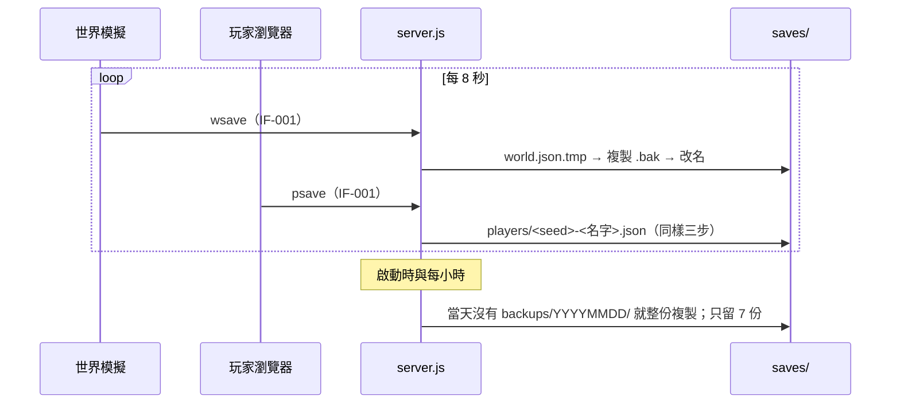

# IF-003：存檔（server ↔ 主機檔案系統 `saves/`）

- 狀態：草稿
- 最後更新：2026-11-20（依 `main` 的 `3147b48` 讀 code 整理；`server.js` 的 `loadSave`、`storeSave`、`SRV`、`snapshot`、`dailyBackup`、`archiveWorld`；`js/save.js` 的 `worldData`、`personal`、`applyWorld`、`applyPersonal`）
- 對應需求：SYS-030～042、SYS-062、SYS-063、SYS-112；QS-010、QS-011、QS-013、QS-043；CON-013
- 雙方：本系統的**主機程式**（`server.js`）↔ 主機那台電腦的**檔案系統**。另一個使用方是**主機管理者**：README 允許他用記事本直接改存檔
- 擁有者：開發者（格式與規則）；主機管理者（檔案所在的電腦）。沒有外部窗口

**內容來源標記**：本文件沒有對方決定的內容。「**現況**」是從 code 讀出、已經實作的；「**目標**」是規格裡標「未實作」的需求。

---

## 1. 概述

多人模式的所有持久資料都放在 `server.js` 旁邊的 `saves/` 資料夾（不進 git）。世界由世界模擬透過 IF-001 的 `wsave` 送來，玩家個人資料由玩家端透過 `psave` 送來，帳號由 server 自己維護；server 負責寫檔、讀檔、備份與封存。單人模式的存檔在瀏覽器 localStorage，不屬於這條介面。

## 2. 協定與傳輸

| 項目 | 內容（現況） |
|---|---|
| 存取方式 | Node `fs` 同步讀寫本機檔案 |
| 位置 | `<server.js 所在資料夾>/saves/`；啟動時自動建立 `saves/players/` |
| 格式 | JSON，`JSON.stringify(data, null, 2)`（縮排 2 格，方便人看、人改） |
| 編碼 | UTF-8，**不帶 BOM**。帶 BOM 的檔案 `JSON.parse` 會失敗，被當成壞檔（README 已提醒手動改檔時不要存成帶 BOM 的 UTF-8） |
| 檔名 | 玩家檔名中的名字：`\ / : * ? " < > | %` 與控制字元換成 `%xx`，中文等其他字元照原樣 |
| 時間 | 封存與備份名稱用主機**本地時間**；檔案內容沒有牆鐘時間，遊戲時間用 `day`、`dayT` |
| 權限 | 沒有特別設定；跟執行 `server.js` 的 Windows 使用者相同。`accounts.json` 只有雜湊，但任何能讀這個資料夾的人都看得到所有名字 |

### 2.1 寫入規則（`storeSave`）

1. 寫到 `<檔名>.tmp`；
2. 如果主檔存在，複製成 `<檔名>.bak`（上一版）；
3. 把 `.tmp` 改名成主檔。

- 寫到一半當機時，主檔不會變成半個檔案（SYS-032）。
- **沒有 `fsync`**：斷電時作業系統可能還沒把資料寫到磁碟，主檔可能是空的或舊的；這時靠 `.bak` 救回。
- Windows 上，檔案正被其他程式開著（防毒、編輯器）時，改名可能失敗；失敗會丟出例外，由呼叫端記錄在主控台（R13）。
- 留下的 `.tmp` 不會被清掉，下一次寫入會直接覆蓋。

### 2.2 讀取規則（`loadSave`）

- **每次都從檔案讀，不快取**：主機管理者手動改的檔案，下次讀取時就生效。
- 先讀主檔，解析失敗（不存在、壞掉、有 BOM）就讀 `.bak`；兩個都不行回傳 `null`，**不會警示**。
- 世界檔回 `null` 時，世界模擬會用新 seed 開一個新世界（現況）；**目標 SYS-034**：只在檔案不存在時才開新世界，存在但讀不懂就拒絕啟動並警示。

## 3. 檔案與資料定義

### 3.1 目錄結構

| 路徑 | 內容 | 誰寫 | 什麼時候寫 |
|---|---|---|---|
| `world.json`（＋`.bak`） | 目前的世界 | server（收到世界模擬的 `wsave`） | 每 8 秒；關閉訊號；後台改世界數值、切換世界等操作前 |
| `world-YYYYMMDD-HHMMSS.json` | 封存的世界（沒有 `.bak`） | server（`archiveWorld`） | 後台開新世界、切換世界時，把目前的 `world.json` 改名 |
| `accounts.json`（＋`.bak`） | 所有帳號 | server | 註冊、產生新 token、後台重設 PIN、刪除帳號 |
| `players/<seed>-<名字>.json`（＋`.bak`） | 每位玩家在每個世界的個人資料 | server（收到玩家的 `psave`） | 玩家端每 8 秒、切走分頁、斷線與重新載入前 |
| `backups/YYYYMMDD/` | 每日備份：`world.json`、`accounts.json`、`players/*.json` | server（`dailyBackup`） | 啟動時與之後每小時檢查，當天還沒有就備份；保留最新 7 份 |
| `backups/restore-YYYYMMDD-HHMMSS/` | 還原前的自動備份（內容同上） | server（`restoreBackup`） | 每次還原前；保留最新 5 份 |

封存世界沒有數量上限，只能從後台手動刪除；刪除封存世界時，該世界的玩家檔留著（IF-002）。

### 3.2 `world.json`（`worldData()`）

| 欄位 | 型別 | 說明 |
|---|---|---|
| `mapW` | 數字 | 地圖寬度（3200／7200／14400）；**沒有這個欄位代表舊的 3200 地圖**（CON-013） |
| `seed` | 數字 | 地形種子；玩家檔名也用它 |
| `day`、`dayT` | 數字 | 第幾天；一天內的進度 0～1 |
| `flags` | `{summoned, boss}` | 是否召喚中；是否打倒過狼王。載入時 `summoned && !boss` 會被重設（進行中王戰消失，SYS-035） |
| `structs` | 陣列 | 建築：`{k 種類, x, y, o 牆方向, fz 熔爐內容, b 箱子內容, cr 作物}`。舊版沒有 `o` 的木牆會自動轉成貼邊的新木牆（SYS-004） |
| `loots` | 陣列 | 地上袋子：`{id, x, y, bag 內容, g 掉落者名字（墓碑）}` |
| `cfg` | 物件 | 這個世界的世界數值；鍵與範圍見 `js/data.js` 的 `CFG_DEF`、`CFG_BOOL`、`CFG_DEATH`，載入時會夾在範圍內 |
| `seen` | 字串 | 共享迷霧：每格 1 bit 打包後的 base64（`packSeen`）；只有多人模式有 |

**不存的**：資源的採集狀態、怪物、進行中的王戰（主機重開後依 seed 重新生成，`01` §8）。

### 3.3 `players/<seed>-<名字>.json`（`personal()`）

| 欄位 | 說明 |
|---|---|
| `inv` | 背包：`{物品名稱: 數量}`（物品名稱是中文，例如 `"木頭": 24`） |
| `dur`、`q` | 每種工具／裝備的耐久、升級等級 |
| `sk` | 熟練度 |
| `eq` | 裝備欄：`{欄位: 物品名稱}`；沒有這個欄位的舊存檔會自動穿上最好的裝備 |
| `known` | 拿過的材料（解鎖配方用） |
| `foods`、`ate` | 生效中的食物效果；是否吃過東西 |
| `spawn` | 重生點 `{x, y}` |
| `p` | 角色：`{x, y, hp, w 手上武器, b 是否在船上}` |
| `hot`、`hotSel` | 8 格快捷欄、選中的格子；沒有的舊存檔會自動排 |
| `pets`、`petOut` | 寵物：`[{id, k 種類, name, hp, bag, down}]`；召喚中的寵物 id |
| `seen` | 個人迷霧（同 `world.json` 的格式），登入時併入共享迷霧 |
| `treant` | 是否打倒過樹精長老 |
| `pins` | 自己的地圖標記 |

server **不檢查內容**，收到 `psave` 就整份寫入（現況；目標 SYS-081 是改成主機為準）。玩家端讀檔時會過濾不認得的物品、把數值夾在範圍內（`applyPersonal`）。

### 3.4 `accounts.json`

```json
{
  "<名字>": {
    "pin": "<salt 16 位 hex>:<scrypt 32 bytes hex>",
    "tokens": ["<sha256 hex>", "…最多 5 個"]
  }
}
```

- 沒有 `pin` 的名字：下次登入時輸入的 PIN 就是新的（後台「重設 PIN」就是刪掉它，R11）。
- 帳號**不會**被還原備份覆蓋。
- PIN 鎖定紀錄不在檔案裡（只在記憶體）。

### 3.5 格式相容規則（現況做法，CON-013）

- 新增欄位時，讀檔端必須能處理**沒有這個欄位的舊檔**（給預設值或自動推算，例如 `eq`、`hot`、`mapW`）。
- 不刪除或改變既有欄位的意義；真的要改格式，可以要求開新世界（不寫新的搬移，`01` §1.2）。
- 沒有格式版本號；靠「欄位有沒有」判斷新舊。

## 4. 互動流程



## 5. 錯誤處理與失效行為

| 情況 | 行為（現況） |
|---|---|
| 主檔壞掉、不存在或有 BOM | 改讀 `.bak`，沒有任何提示 |
| 主檔與 `.bak` 都讀不懂 | 世界：默默開新世界（SYS-034 目標是拒絕並警示）；玩家：當成新玩家；帳號：當成沒有任何帳號（**所有名字都能重新註冊**） |
| 寫檔失敗（磁碟滿、權限、檔案被鎖） | 例外在主控台印「存檔出錯」，遊戲繼續；下一次寫入會再試（R13） |
| 備份失敗 | 主控台印「備份失敗」，一小時後再試 |
| 主機管理者在世界運作時改 `world.json` | 8 秒內被世界模擬蓋回去（README：先關黑色視窗再改） |
| 主機管理者在玩家在線時改他的玩家檔 | 會被玩家端下一次 `psave` 蓋回去（README：等那個人離線再改） |

**冪等性**：每次寫入都是整份覆蓋，重寫同樣的內容結果相同。**並行**：Node 單執行緒同步寫檔，不會有兩個寫入交錯；但 server 跟手動編輯之間沒有鎖。

## 6. 非功能

| 項目 | 內容 |
|---|---|
| 檔案大小 | `<待確認：14400 地圖的 world.json 與一般玩家檔實際大小，可實測>`；`seen` 是主要的大欄位 |
| 磁碟用量 | 約為「目前存檔 ×（1 份 `.bak` ＋ 7 份每日備份 ＋ 5 份還原前備份）＋ 所有封存世界」；沒有自動清理封存世界 |
| 寫入頻率 | 世界每 8 秒一次；每位在線玩家每 8 秒一次（6 人時約每秒 1 次寫檔） |
| 測試 | `tests/17-admin-saves-accounts.mjs` 用自己的測試資料夾（`tests/.tmp`）；`.bak` 退回、BOM、兩份都壞的情況沒有測試（R2） |
| 備份保存 | 每日 7 份、還原前 5 份；沒有異地備份（README 建議手動複製整個 `saves/`） |
| 憑證、密鑰 | 無；PIN 鹽與雜湊在 `accounts.json` |

## 7. 待確認問題

這條介面只在主機那台電腦內部，**沒有要問外部窗口的問題，也沒有申請項目**。

開發者自己的待辦（已記入 `spec-progress.md`）：

| # | 事項 | 影響 |
|---|---|---|
| 1 | 實測 14400 地圖的 `world.json` 與玩家檔大小 | §6；R8 訊息上限（`wsave`／`psave` 走 IF-001） |
| 2 | `accounts.json` 兩份都壞時，所有名字都能被重新註冊、拿走別人的玩家檔，是否要跟 SYS-034 一樣拒絕啟動 | §5；STK-004 |
