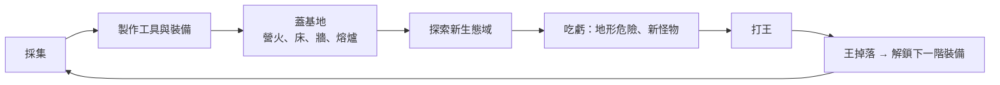

# 北境求生 遊戲設計企劃

草稿 v0.1 · 2026-11-17 · 依 `main`（`1ef555b`）現況撰寫

標示說明：**【現況】** 是程式裡已經有的；**【提案】** 是這份企劃新提出、還沒做的；**【待定】** 需要拍板。

---

## 1. 遊戲概述

北境求生是一款俯視角的生存建造遊戲，打開瀏覽器就能玩，也能和同一個區網的同事一起玩。玩家從草地出發，一路採集、製作、蓋基地、打王，最後搭船前往更危險的外大陸。

| 項目 | 內容 |
|---|---|
| 類型 | 俯視角 2D 生存、建造、打王 |
| 平台 | 瀏覽器（單一 HTML 檔），支援鍵鼠與觸控 |
| 遊玩方式 | 單人：直接開檔，存在瀏覽器；多人：`開主機.bat` 開 server，同事用區網網址加入 |
| 一局長度 | 長期世界，不會結束；本企劃把「打倒最終王」定為主線完結 |
| 目標玩家 | 同事之間午休、下班後一起開的小團體（2～6 人） |

**核心體驗**：每到一個新生態域，都先吃一次虧（被燒、被拖慢、被夜裡的怪圍），再用上一區的戰利品做出對策，回頭征服它。

---

## 2. 核心循環

- **短循環（一個晚上）**：白天採集、製作，晚上（日夜一輪 360 秒）回基地烤肉、睡覺。
- **中循環（一個生態域）**：取得該區資源 → 做出下一階工具 → 打該區的王。
- **長循環（整場）**：草地 → 森林 → 沼澤 → 出海 → 雪山 → 魔法森林 → 火山。

---

## 3. 現況盤點

### 3.1 已實作的系統【現況】

| 系統 | 內容 |
|---|---|
| 採集 | 範圍攻擊一次打到扇形內所有樹、石頭、敵人 |
| 製作 | 工作台附近製作；分「裝備」「建築」兩類；可一次做多個 |
| 建造 | B 進建造模式；營火、工作台、床、木牆、石牆（貼格子邊，R 轉向）、熔爐、船、水晶燈；拆除退回材料 |
| 採礦 | 煤、銅、錫（燧石鎬）、鐵（銅鎬）；熔爐把礦燒成錠 |
| 戰鬥 | 7 種武器 + 拳頭；翻滾閃避；耐力 |
| 護甲 | 皮甲（減傷 30%）、樹精裝備（減傷 45%、回血）；擁有即生效 |
| 寵物 | 野豬（餵莓果）、奶蛙（餵蘑菇）、狼崽（首次打倒狼王）；倒下 60 秒復活 |
| 王 | 狼王（三招輪流）、王樹精（四招）；都在石祭壇召喚，可重複打 |
| 地圖 | 3200 / 7200 / 14400 三種大小；小地圖、大地圖、戰爭迷霧（多人共享） |
| 生態域 | 海、沙灘、草地、森林、雪地、沼澤、火山灰、熔岩、魔法森林 |
| 介面 | 快捷欄 1～8、背包格子拖曳、SVG 圖示、黑白濾鏡（G） |
| 多人 | server 跑世界、名字＋PIN 登入、存檔在主機、每日備份 |
| 裝飾 | ASCII 魚群與鯊魚 |

### 3.2 已知缺口

| # | 缺口 | 影響 |
|---|---|---|
| G1 | **錫錠、鐵錠沒有任何配方會用到** | 熔爐燒出來沒用，金屬線斷在銅鎬 |
| G2 | **船只要木頭 20＋樹脂 4** | 第一天就能出海，外大陸沒有門檻 |
| G3 | **魔力水晶是 tier 1** | 燧石鎬就挖得動，魔法森林等於新手區 |
| G4 | **特殊生態域沒有專屬怪物** | 怪物只生在沙灘、草地、森林；雪地、沼澤、火山只有地形效果，探索起來很空 |
| G5 | **兩隻王都在同一個祭壇，跟生態域無關** | 打王不會帶玩家去新地方 |
| G6 | **外大陸由 `(k+o)%3` 隨機分配，距離相同** | 無法用遠近排順序 |
| G7 | **沼澤在本大陸、佔 1/5** | 出生後很快就會走進去，比預期的階段早 |
| G8 | ~~地上物品袋在主機重開後消失~~ | 已修正（第 9 項：袋子跟著世界存檔） |

---

## 4. 生態域與難度進程【提案】

原則：**每一區的危險，用上一區的戰利品克服；每一區的資源，用來打開下一區。**

| 階段 | 生態域 | 位置 | 危險 | 進入門檻 | 主要產出 | 王 |
|---|---|---|---|---|---|---|
| 1 | 草地／沙灘 | 本大陸中心 | 野豬 | 無 | 木、石、燧石、莓果、皮革 | — |
| 2 | 森林 | 本大陸 | 苔精、奶蛙 | 燧石武器 | 樹脂、蘑菇、銅、錫 | 狼王 |
| 3 | 沼澤 | 本大陸邊緣 | 減速 55%、新怪 | 青銅鎬才挖得動鐵 | 鐵 | 王樹精 |
| 4 | 雪山 | 外大陸 | 耐力加倍、寒冷 | 鐵船＋保暖裝備 | 寒鐵（新） | 新王 A |
| 5 | 魔法森林 | 外大陸 | 夜晚苔精大量出現 | 寒鐵鎬挖水晶 | 魔力水晶 | 新王 B |
| 6 | 火山 | 外大陸 | 熔岩燃燒 | 抗火裝備 | 終局材料 | 最終王 |

### 排序理由

- **1～3 都在本大陸**，走路就到。新手不用碰船；沼澤的減速是中期第一道牆。
- **雪山在前**：耐力加倍很煩，但不直接扣血。
- **魔法森林第二**：白天安全，晚上危險，有「趕在天黑前撤退」的節奏。
- **火山最後**：熔岩每秒扣 2 血、離開後還燒 5 秒，是現有最兇的地形。

### 外大陸的順序怎麼保證

不改地圖分配（G6），**改靠裝備門檻**：沒有抗火裝備去火山會被燒回來，沒有保暖裝備去雪山會凍傷。玩家可以亂跑，但會自然被推回正確順序。

**【待定】** 沼澤要不要從本大陸移到外大陸？保留在本大陸較簡單，但要接受玩家可能提早進去（G7）；靠「鐵礦只生在沼澤＋需青銅鎬」來限制收穫，而不是限制進入。

---

## 5. 資源與礦物階級【提案】

| 鎬等級 | 鎬 | 可挖 | 現況 |
|---|---|---|---|
| 1 | 燧石鎬 | 大石頭、煤、銅、錫 | 有 |
| 2 | 青銅鎬（新，取代銅鎬的位置） | ＋鐵 | 現在是銅鎬挖鐵 |
| 3 | 鐵鎬（新） | ＋寒鐵 | 無 |
| 4 | 寒鐵鎬（新） | ＋魔力水晶 | 水晶現在是 1 級（G3） |

| 材料 | 產地 | 用途 |
|---|---|---|
| 銅＋錫 → **青銅錠** | 森林 | 青銅鎬、青銅武器（解決 G1 的錫） |
| 鐵錠 | 沼澤 | 鐵鎬、鐵甲、**船**（解決 G1、G2） |
| 寒鐵 | 雪山 | 寒鐵鎬、保暖裝備 |
| 魔力水晶 | 魔法森林 | 抗火裝備、水晶燈、魔法武器 |
| 終局材料（暫名「熔核」） | 火山 | 最終武器 |

**【待定】** 銅鎬要直接改名青銅鎬，還是保留銅鎬再多一階？保留會讓階段變多、節奏變慢。

---

## 6. 裝備進程【提案】

| 階段 | 工具 | 武器 | 護甲 | 現況 |
|---|---|---|---|---|
| 1 | 燧石斧、燧石鎬 | 木棒、燧石矛 | 皮甲（減傷 30%） | 有 |
| 2 | 青銅鎬 | 青銅劍、狼牙劍 | 青銅甲 | 狼牙劍有，其餘新增 |
| 3 | 鐵鎬 | 鐵劍 | 鐵甲；樹精裝備（回血） | 樹精裝備有 |
| 4 | 寒鐵鎬 | 寒鐵武器 | 毛皮披風（保暖） | 新增 |
| 5 | — | 樹精法杖（遠程）、水晶法杖 | 水晶護符（抗火） | 法杖有 |
| 6 | — | 最終武器 | — | 新增 |

設計規則：
- 每一階的近戰武器傷害約為上一階的 1.5 倍（目前燧石矛 20 → 狼牙劍 38）。
- 護甲目前「擁有即生效、取最好的」，**保留這個簡化**；特殊效果（保暖、抗火）改成「擁有即生效」的配件，可以和護甲同時生效。

**【待定】** 配件要不要做成獨立欄位？還是一樣「放在背包就生效」？

---

## 7. 敵人與王【提案】

### 7.1 各生態域怪物

| 生態域 | 現有 | 提案新增 |
|---|---|---|
| 草地 | 野豬 | — |
| 森林 | 苔精、奶蛙 | — |
| 沼澤 | 無（G4） | 奶蛙移到沼澤為主；新增會吐毒的沼澤怪 |
| 雪山 | 無 | 雪狼群（成群出現，速度快） |
| 魔法森林 | 夜晚苔精變多 | 發光精靈（遠程） |
| 火山 | 無 | 熔岩怪（不怕熔岩，會把玩家擠進熔岩） |

### 7.2 王

| 王 | 生態域 | 召喚方式 | 招式 | 掉落與解鎖 | 現況 |
|---|---|---|---|---|---|
| 狼王 | 森林 | 石祭壇，3 獠牙＋5 樹脂 | 衝刺撲擊、三連抓、綠光怒吼 | 狼王之牙、皮革、首次給狼崽 | 有 |
| 王樹精 | 沼澤 | 古樹種子 | 樹枝重擊、根鬚纏繞、種子投擲、自然恢復 | 堅硬樹皮、古老樹枝、自然精華、樹精核心 | 有（目前也在石祭壇） |
| 新王 A | 雪山 | 待定 | 待定 | 寒鐵相關 | 新增 |
| 新王 B | 魔法森林 | 待定 | 待定 | 水晶相關 | 新增 |
| 最終王 | 火山 | 待定 | 待定 | 主線完結 | 新增 |

**【待定】** 每個生態域各自一座祭壇，還是維持一座石祭壇、靠不同祭品叫不同的王？各自祭壇能解決 G5（打王會帶玩家去新地方），但要改地圖生成。

---

## 8. 環境機制

| 機制 | 地點 | 效果 | 對策 | 現況 |
|---|---|---|---|---|
| 夜晚 | 全地圖 | 怪變多、變暗 | 營火、水晶燈、床、牆 | 有 |
| 沼澤減速 | 沼澤 | 移動 ×0.55（含王樹精） | 【提案】沼澤靴 | 減速有，對策無 |
| 雪地耐力 | 雪地 | 衝刺、翻滾耐力 ×2 | 【提案】毛皮披風減半 | 耐力有，對策無 |
| 寒冷 | 雪地 | 【提案】不在營火旁會慢慢扣血 | 營火、毛皮披風 | 無 |
| 熔岩 | 火山 | 著火 5 秒，玩家每秒 2 血、怪每秒 4 血 | 【提案】水晶護符免疫 | 燃燒有，對策無 |
| 海 | 全地圖 | 走不過去 | 船 | 有 |

---

## 9. 多人與存檔【現況】

- **世界由 server 執行**：`server.js` 用 Node 跑同一份遊戲程式，每秒模擬 30 次；所有瀏覽器分頁都是玩家，主機分頁可以關。
- **帳號**：名字＋4～8 位 PIN；瀏覽器記住登入記號；PIN 錯 5 次鎖 1 分鐘。
- **存檔**：`saves/world.json`（世界）、`saves/accounts.json`（帳號）、`saves/players/`（每人背包、寵物、地圖）；每天備份到 `saves/backups/`，留 7 天。
- **迷霧共享**：任何人看到的地方，所有人的地圖都會亮。
- **寵物**：由主人那一端模擬，狀態隨玩家同步。

新功能開發時要注意：新加的頂層瀏覽器 API 要在 `server.js` 的 `startSim` 補 stub，否則 server 上的世界會跑不起來。

---

## 10. 開發路線圖

先把貫穿全遊戲的基礎系統做完，再規劃生態系 1 → 2。順序依「誰依賴誰」與「越晚改越痛（存檔格式）」排定。遊戲進度可以重來，不做舊存檔搬移。

### 10.1 系統分類

| 分類 | 項目 |
|---|---|
| 物資系統 | 儲存箱、負重上限、耐久系統 |
| 科技系統 | 工作台升級、裝備系統（含升級）、配方系統（取得新材料才解鎖新配方） |
| 技能系統 | 熟練度系統 |
| 戰鬥系統 | 格擋與防禦機制 |
| 懲罰系統 | 死亡機制 |
| Buff & Debuff | 舒適度系統、食物系統（含農業）、地形／天氣／異常怪 |
| 地圖相關 | 地圖生成改進（一個島多個生態系）、地圖標記、傳送門 |
| 音效系統 | 音效、音量 |
| 設定選單 | 統一放各種開關 |
| 多人遊戲 | 表情動作、ping |

### 10.2 製作順序

| 順序 | 項目 | 依賴與理由 | 狀態 |
|---|---|---|---|
| 1 | 設定選單 | 先做出放開關的地方（黑白、之後的音量） | 完成 |
| 2 | 地圖標記＋ping | 兩者都是「地圖上的點」，共用程式 | 完成 |
| 3 | 負重上限＋儲存箱 | 必須一起上；改存檔格式，越早越好 | 完成 |
| 4 | 耐久系統 | 在工作台修理，接第 6 項 | 完成 |
| 5 | 配方系統 | 獨立；記錄拿過哪些材料 | 完成 |
| 6 | 工作台升級 | 裝備升級需要工作台等級 | 完成 |
| 7 | 裝備系統（含升級） | 裝備欄位是格擋（盾）的前提 | 完成 |
| 8 | 格擋與防禦 | 需要盾牌欄位；右鍵要從翻滾讓出來 | 完成 |
| 9 | 死亡機制 | 需要背包上限，否則懲罰太重 | 完成 |
| 10 | 食物系統（料理 → 農業） | 農業供應料理材料 | 完成 |
| 11 | 舒適度系統 | 需要足夠的家具（箱子、工作台、料理台） | 完成 |
| 12 | 熟練度系統 | 所有動作定案後才知道有哪些技能 | 完成 |
| 13 | 音效系統 | 動作定案後一次補齊；預設靜音 | 完成 |
| 14 | 地圖生成改進＋地形、天氣、異常怪 | 即「生態系 1 → 2」規劃；開新世界 | |
| 15 | 傳送門 | 外大陸開放後 | |
| 隨時 | 表情動作 | 無依賴 | 完成 |

每一項一個 commit，做完都可以單獨上線。

---

## 11. 待決定事項

- [ ] 生態域順序：雪山 → 魔法森林 → 火山，同意嗎？
- [ ] 沼澤留在本大陸，還是移到外大陸？
- [ ] 銅鎬改名青銅鎬，還是多一階？
- [ ] 保暖、抗火做成獨立配件欄，還是放背包就生效？
- [ ] 王的祭壇：每個生態域一座，還是維持一座石祭壇？
- [ ] 主線完結後要做什麼？（例如：更難的世界、重生加成，或者就停在這裡）
- [ ] 現有的 14400 世界要沿用，還是第 1 期上線後開新世界？（礦物階級改變會影響已經挖到的進度）

---

## 12. 後台管理頁

主機那台電腦用瀏覽器開 `http://localhost:8080/admin`，管理世界、存檔與玩家，不用再手動改 `saves/` 裡的檔案。

### 12.1 架構

| 項目 | 做法 |
|---|---|
| 誰能用 | 只限主機那台電腦（連線來源必須是本機）；區網的同事連不進來 |
| 網頁 | `admin.html`，由 `server.js` 提供，零依賴 |
| 介面 | `server.js` 提供 `/api/admin/*` JSON 介面；要改世界時，server 直接傳訊息給它自己在跑的世界 |
| 安全 | 只接受本機連線與 `localhost` 網址；會改東西的請求必須帶自訂標頭，擋掉其他網頁偷送的請求 |
| 數值存放（第 3 期） | `saves/config.json`，玩家連線時一起傳給每個人 |

### 12.2 分期

| 期 | 內容 | 狀態 |
|---|---|---|
| 1 | **總覽**：線上玩家、世界天數與時段、怪物數、王、server 開了多久 **世界存檔**：目前世界與封存的舊世界列表；開新世界、切換到舊世界、刪除、下載；每日備份列表與還原（還原前自動再備份一次） **玩家帳號**：帳號列表、重設 PIN、踢出、刪除帳號 | 完成 |
| 2 | 暫停／繼續世界、跳到白天或夜晚、清怪、結束王戰、對所有人發公告 | 完成 |
| 3 | 世界數值：難度倍率、掉落與採集量、生長與熔爐速度、一天長度、死亡懲罰、背包格數、耐久與熟練度倍率（等玩過一陣子再決定做哪些） | |

不做：直接修改玩家背包或送東西（容易變成作弊，而且線上玩家的存檔會蓋掉修改）。
